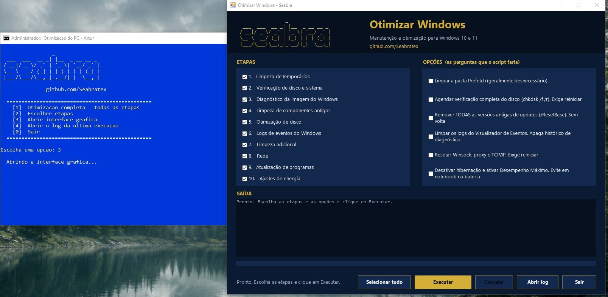

      
# Otimizar Windows

Script `.bat` de manutenção e otimização para Windows 10/11, com **menu no terminal** e uma **interface gráfica** opcional. Pede permissão de administrador sozinho, roda em 10 etapas que você pode escolher e grava um log de cada execução.

## ⚠️ Aviso

O script faz alterações reais no sistema: apaga arquivos temporários, reinicia o serviço do Windows Update, roda verificações de disco e de sistema, limpa componentes antigos do Windows, otimiza o disco e pode alterar rede e plano de energia. **Leia o código antes de rodar** e use por sua conta e risco.

As ações mais pesadas **sempre perguntam antes** (ou aparecem como caixas desmarcadas na interface gráfica): Prefetch, `chkdsk /f /r`, `/ResetBase`, logs de eventos, reset de rede e plano de energia.

## Arquivos

| Arquivo | Para que serve |
|---|---|
| `otimizar.bat` | O script principal, com o menu no terminal |
| `OtimizarGUI.ps1` | A interface gráfica (opcional). Precisa estar **na mesma pasta** do `.bat` |
| `otimizar_log.txt` | Criado a cada execução, ao lado do `.bat` |

## Como usar

1. Baixe o `otimizar.bat` e, se quiser a janela gráfica, também o `OtimizarGUI.ps1`, e deixe os dois na mesma pasta
2. Dê duplo clique no `otimizar.bat`. Ele pede permissão de administrador automaticamente
3. Escolha uma opção do menu:
   - **1** — Otimização completa, com todas as etapas
   - **2** — Escolher etapas (digite os números separados por vírgula, por exemplo `1,5,7`)
   - **3** — Abrir a interface gráfica
   - **4** — Abrir o log da última execução
   - **0** — Sair
4. Responda às perguntas S/N durante a execução
5. Reinicie o computador ao final para aplicar todas as mudanças

## Interface gráfica (beta)

Abre uma janela com as 10 etapas como checkboxes, as perguntas do script como opções (todas desmarcadas por padrão), saída ao vivo, barra de progresso e botão **Cancelar**. Ela não tem código de limpeza próprio: executa o `otimizar.bat` em um modo sem perguntas, então o comportamento é o mesmo do terminal.

- Precisa de administrador (pede sozinha, se necessário) e do PowerShell 5.1, que já vem no Windows 10/11
- É aberta pelo menu (opção 3) com `-ExecutionPolicy Bypass` apenas para aquele processo, sem mudar a configuração do seu Windows
- Esta parte é nova e ainda está em fase de testes. Se algo ficar estranho, o menu no terminal continua funcionando normalmente

## O que o script faz

1. **Limpeza de arquivos temporários**
   - `%temp%`, `C:\Windows\Temp` e `Recent`
   - Cache do Windows Update (`SoftwareDistribution\Download`, com parada segura do serviço `wuauserv`)
   - Cache de miniaturas e de ícones
   - Relatórios de erro do Windows (WER)
   - **Prefetch — opcional.** Usa o SID de Administradores, então funciona em Windows de qualquer idioma

2. **Verificação de disco e arquivos de sistema**
   - `chkdsk /scan` (online)
   - `chkdsk /f /r` **opcional** (exige reiniciar o PC)
   - `sfc /scannow`

3. **Diagnóstico da imagem do Windows**
   - `DISM /CheckHealth` e `/ScanHealth` (rápidos, só diagnosticam)
   - O `/RestoreHealth` **não roda automaticamente**, por ser demorado e instável em alguns PCs. Se o diagnóstico apontar corrupção, rode manualmente: `DISM /Online /Cleanup-Image /RestoreHealth`

4. **Limpeza de componentes antigos (WinSxS)**
   - `/AnalyzeComponentStore` — mostra quanto espaço pode ser recuperado
   - `/StartComponentCleanup` — remove componentes já substituídos, mantendo a opção de desinstalar a atualização mais recente
   - `/ResetBase` — **opcional**: libera mais espaço, mas remove a opção de desinstalar atualizações já aplicadas

5. **Otimização de disco**
   - Identifica o disco onde está o `C:` e aplica `TRIM` (SSD) ou desfragmentação (HDD)
   - Se não conseguir identificar o tipo, roda a otimização padrão do Windows

6. **Logs de eventos do Windows — opcional**
   - Pergunta antes de limpar o Visualizador de Eventos, pois isso apaga histórico útil para diagnóstico

7. **Limpeza adicional**
   - Limpeza de Disco nativo (`cleanmgr /sagerun`) com uma lista **segura** de categorias: arquivos temporários, miniaturas, relatórios de erro, cache de internet, cache de shaders, Delivery Optimization e similares
   - **Não toca** na pasta Downloads, na Lixeira nem em itens de rollback do Windows (instalações anteriores, pacotes de drivers)
   - Ativa o **Storage Sense**. Atenção: com ele ligado, o Windows passa a limpar temporários automaticamente e, pelas configurações padrão, também itens da Lixeira com mais de 30 dias

8. **Rede**
   - Limpa o cache DNS e renova o IP (a conexão pode cair por alguns segundos)
   - Reset de **Winsock, proxy do WinHTTP e TCP/IP** — **opcional** (exige reiniciar o PC)

9. **Atualização de programas (Winget)**
   - `winget upgrade --all`, com busca do executável quando ele não está no PATH da sessão elevada

10. **Ajustes de energia — opcional**
    - Desativa a hibernação e ativa o plano de Desempenho Máximo (ou Alto Desempenho, se o primeiro não estiver disponível). Não recomendado para notebooks usando bateria

## Log e outros detalhes

- O `otimizar_log.txt` registra a hora de início de cada etapa. Se algo travar, ele mostra onde parou.
- O script desativa o **QuickEdit Mode** do console (configuração do usuário atual), para que um clique acidental na janela não pause a execução. Isso vale também para outras janelas de terminal.
- A janela é aberta com `cmd /k`, então não fecha sozinha em caso de erro.
- O console usa o tema azul e dourado (`color 1E`). Para mudar, edite essa linha no `.bat`.

## Requisitos

- Windows 10 ou 11
- Winget instalado (já vem em versões recentes do Windows)
- Conexão com a internet (para a etapa de atualização de programas)

## Licença

MIT — sinta-se livre para usar, modificar e distribuir, citando a fonte.

